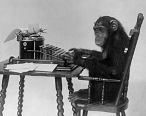

<div align="center">

# 🐒 Infinite Monkey Theorem

**Exploring randomness, probability, and the improbable emergence of meaning.**



<sub><i>A chimpanzee seated at a typewriter — the classic illustration of the theorem.</i></sub>

<br/>


</div>

---

## 📖 Overview

The **Infinite Monkey Theorem** states that a monkey hitting keys at random on a typewriter for an infinite amount of time will *almost surely* type any given text — including the complete works of William Shakespeare.

This project explores that idea computationally: comparing purely random text generation with smarter strategies, from simple statistical models to modern language models, and measuring just how far "random" really is from "meaningful."

## 🧮 The Math in Brief

For an alphabet of size $k$ and a target string of length $n$, the probability that a single random attempt matches the target is:

$$
P(\text{match}) = \left(\frac{1}{k}\right)^{n}
$$

With $k = 27$ (26 letters + space), even the short phrase `to be or not to be` (18 characters) has a chance of roughly **1 in 5.8 × 10²⁵** per attempt. The theorem holds because, over infinitely many attempts, the probability of *never* succeeding tends to zero:

$$
\lim_{N \to \infty} \left(1 - P(\text{match})\right)^{N} = 0
$$

Infinity does the heavy lifting — in any finite universe, the monkey is very unlikely to finish *Hamlet*.

## 🎯 Project Goals

- **Simulate** pure random typing and measure progress against target texts.
- **Compare** random generation with guided approaches (e.g. cumulative selection, n-gram models, small and large language models).
- **Visualize** how quickly each strategy converges on meaningful output.
- **Explain** the probability theory behind the results in an accessible way.

## 🗂️ Repository Structure

```
Infinite-Monkey-Theorem/
├── assets/
│   └── monkey-typewriter.png
└── README.md
```

> The structure will grow as simulations and experiments are added.

## 🚀 Getting Started

```bash
git clone https://github.com/Hirukadeven07/Infinite-Monkey-Theorem.git
cd Infinite-Monkey-Theorem
```

## 🗺️ Roadmap

- [ ] Random-typing simulator
- [ ] Cumulative-selection ("weasel") experiment
- [ ] N-gram language model baseline
- [ ] SLM / LLM comparison
- [ ] Charts and results write-up

## 🤝 Contributing

Contributions, ideas, and discussions are welcome. Please open an issue to propose a change, or submit a pull request.

## 📜 License

This project is released under the MIT License.

## 🙏 Acknowledgements

- Image: *Chimpanzee seated at typewriter*, public domain, via Wikimedia Commons.
- Inspired by Émile Borel's 1913 formulation of the theorem and its many appearances in mathematics and popular culture.

<div align="center">

---

<sub>Given enough time, anything is possible. 🐒⌨️</sub>

</div>
