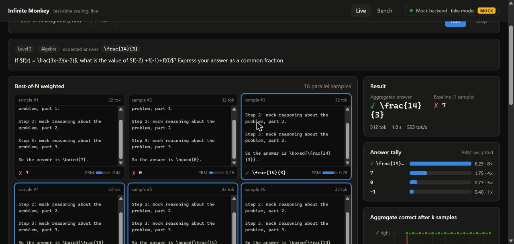

<div align="center">

# Infinite Monkey Theorem


</div>

Watch a small language model (Qwen3) solve math problems many times at once, and see how giving it more compute at test time improves its answers, live in your browser.



## What you need

- Python 3.11 or newer
- A Google Colab account with a GPU (L4 or A100 recommended)

## Setup (once)

```bash
python -m venv .venv
.venv/Scripts/pip install -r requirements.txt      # macOS/Linux: .venv/bin/pip
```

## Get started

1. **Start the models.** Open `colab/tts_server.ipynb` in Colab, choose a GPU runtime, and click **Run all**. The first run takes 5–15 minutes.
2. **Start the site.** Run the command below, then open <http://127.0.0.1:8000>.
   ```bash
   .venv/Scripts/python -m uvicorn app.main:app --host 127.0.0.1 --port 8000
   ```
3. **Connect them.** Click the backend pill in the site's top-right corner, choose **Colab**, and paste the **URL** and **TOKEN** printed by the notebook's last cell. Both change every session.

Until you connect, the site uses a fake model so you can try it offline.

## Using it

- **Live:** pick a question, a method and how many answers to generate, press **Run**, and watch the answers stream in.
- **Bench:** run a set of MATH-500 questions and compare each method's accuracy against a single-answer baseline. If Colab disconnects, press **Resume** to continue.

## When you're done

Stop the Colab runtime: in Colab, go to **Runtime → Manage sessions → Terminate**. Closing the notebook doesn't stop it, and it keeps using compute units.

## Reference

Based on Snell et al. (2024), *Scaling LLM Test-Time Compute Optimally can be More Effective than Scaling Model Parameters*. [arXiv:2408.03314](https://arxiv.org/abs/2408.03314)
